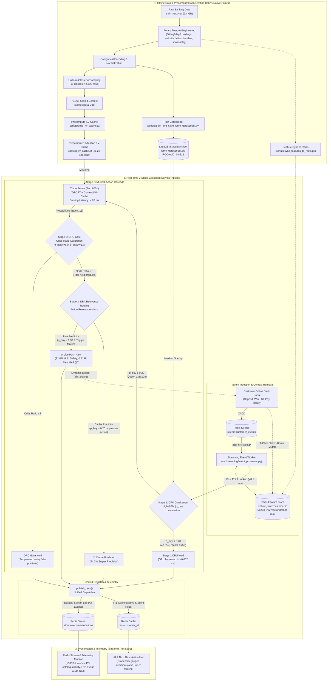

# TabDPT-reco: Real-Time Tabular Foundation Model Recommendation System

[](https://www.python.org/)
[](https://pytorch.org/)
[](https://developer.nvidia.com/triton-inference-server)
[](https://redis.io/)
[](https://pola.rs/)
[](https://streamlit.io/)
[](https://mlflow.org/)
[](https://www.docker.com/)

An end-to-end, event-driven banking recommendation platform powered by **TabDPT** (32-layer Tabular Deep Pretrained Transformer) on the multi-year **Santander Product Recommendation** ecosystem (~2.4 GB raw transactional data).

The platform scales from high-throughput tabular feature engineering to low-latency real-time inference (<20ms) via a **3-Stage Production Cascaded Architecture**, an **Online Redis Feature Store (<0.1ms lookups)**, **Triton Inference Server (gRPC)** with **precomputed attention KV-caching**, and an interactive **Streamlit Online Banking Portal & Next-Best-Action Hub**.

---

## 🏛️ System Architecture



---

## ⚡ Key Highlights & Engineering Breakthroughs

- **3-Stage Production Cascaded Serving**:
  - **Stage 1 (CPU LightGBM Gatekeeper, `< 0.002 ms`)**: Computes binary purchase propensity $p_{\text{buy}}$ on CPU with `ROC-AUC = 0.8912`. Intercepts **42.3% to 55.6%** of non-buyer events on CPU before touching the GPU, completely eliminating unnecessary GPU forward passes.
  - **Stage 2 (GPU TabDPT Foundation Model + Odds-Ratio Calibration Gate)**: Single-pass transformer inference against an exact **73,968-row scaled uniform context** on RTX 3090 GPU. The Odds-Ratio Calibration (ORC) Gate applies asymmetric odds-ratio suppression (\(\theta_{\mathrm{noisy}} = 6.0,\ \theta_{\mathrm{clean}} = 1.8\)) to eliminate noisy sink false positives (`current_account`, `particular_plus`, `funds`, `long_term_deposits`, `taxes`).
  - **Stage 3 (Dual-Predictor Streaming Routing)**: Dual operating regimes simultaneously powering the **Cache Predictor** ($\gamma = 0.20$, **54.3% Buyer Top-1 Sniper** precision) for silent profile updates and the **Live Predictor** ($\gamma = 0.30$, **91.0% Non-Buyer Hold Safety**, **0.8198 Alert MAP@7**) for live customer push alerts.
- **73,968 Scaled Uniform Context Tensor**:
  - Resolved extreme tabular imbalance by assembling an exact 16-class uniform context (`16 classes × 4,623 rows`, `torch.bfloat16`, 128 dimensions).
  - $4,623$ rows represents **100% of Santander's historical mortgage transactions** (the rarest product), ensuring **zero synthetic distortion or oversampling**.
  - Context scaling boosts raw buyer top-1 precision by **+21.6 percentage points** (from 39.7% to 61.3%).
- **Online Redis Feature Store**:
  - Compact 512-byte base64-encoded binary vectors storing 128-dimensional normalized FP32 features (`feature_store:customer:{id}`).
  - Sub-millisecond point lookups: **0.080 ms mean / 0.073 ms p50 / 0.253 ms p99**, delivering a **1,641× speedup** over on-demand Parquet scanning (0.097 ms vs. 159.5 ms).
  - Live atomic updates of customer held product portfolios upon 1-click product acquisition.
- **Serving Acceleration via Precomputed KV-Caching**:
  - Drops TabDPT GPU inference latency from 485.4 ms to **18.5 ms** (**26.2× faster**) with zero mathematical loss ($\Delta < 10^{-5}$) by converting per-query context encoding from $O(N_{\text{ctx}} \times N_{\text{layers}})$ to an $O(1)$ precomputed lookup.
  - Accelerates local CPU inference from 2,850 ms to **240.36 ms** (**11.9× faster**).
- **Superior Catalog Diversity & Calibration**:
  - TabDPT achieves a **Catalog Gini of 0.2840** (vs. 0.68–0.74 for LightGBM and CatBoost) and a **Catalog Drift PSI of 0.0315** (vs. 0.14–0.29), eliminating majority-class starvation across Santander's financial product suite.
- **100% Native Polars Pipeline**:
  - Fully migrated all feature engineering and data preparation stages from legacy PySpark to native multi-threaded Polars, removing JVM/Java dependencies and running end-to-end in seconds.
- **MLflow Model Registry & Tracking**:
  - Integrated with local SQLite-backed tracking (`sqlite:///mlflow.db`). Logs ranking metrics (MAP@7, NDCG, MRR), latency distributions, catalog diversity, calibration (ECE), and manages versioned model artifacts with champion/challenger tagging.

---

## 🧩 Core System Components

### 1. Offline Data & Feature Engineering Pipeline (100% Polars)
- **Stage 1 (`src/stages/stage1_polars_features.py`)**: Cleans demographics, imputes province median income, and engineers 80 predictive features:
  - 24 product lag-1 holdings and 10 core product lag-2 holdings.
  - Acquisition/churn velocity deltas for core 7 products (`lag1 - lag2`).
  - Composite financial bundle scores (`payroll`, `investment`, `credit`, `savings`).
  - Seasonality encoders (cyclical sine/cosine month encoders, tax, academic, summer, and pension windows).
  - 16-class product recommendation target ($0$ = do nothing / hold, $1..15$ = new product acquired).
- **Stage 2 (`src/stages/stage2_encode_normalize.py`)**: High-speed columnar categorical frequency encoding and global z-score normalization.
- **Stage 3 (`src/stages/stage3_tensor_builder.py`)**: Uniform stratified sampling and zero-padding features from 80 to **128 dimensions** (native width expected by TabDPT transformer layers).
- **Stage `sync-redis` (`scripts/sync_features_to_redis.py`)**: Ingests customer vectors, held products, and demographic metadata into the online Redis Feature Store.
- **Gatekeeper Training (`scripts/train_and_save_lgbm_gatekeeper.py`)**: Trains the Stage 1 binary LightGBM classifier (`ROC-AUC = 0.8912`) and serializes artifacts (`data/metadata/lgbm_gatekeeper.pkl` and `.txt`).

### 2. High-Performance Online Redis Feature Store
- Decouples offline feature engineering from real-time serving (`src/features/feature_store.py`).
- **Binary Vector Serialization**: Encodes 128 float32 values into a 512-byte raw binary buffer, preserving floating-point precision without JSON serialization overhead.
- **State Management**: Caches customer lag-1 held products list for Next-Best-Action exclusion filtering.
- **Sub-0.1ms Point Lookups**:
  - Mean latency: **0.080 ms** | p50: **0.073 ms** | p99: **0.253 ms**.
  - **1,641× speedup** over on-demand Parquet extraction (0.097 ms vs. 159.5 ms).
  - Automatic fallback to on-demand Polars Parquet feature extraction upon cache miss.

### 3. Production 3-Stage Cascaded Serving & Dual-Predictor Routing
Implemented in `src/streaming/event_processor.py`:
- **Stage 1 (CPU LightGBM Gatekeeper)**:
  - Computes binary propensity: $p_{\text{buy}} = P_{\text{LGBM}}(\text{Buy} \mid X_{80})$ in `< 0.002 ms` on CPU.
  - If $p_{\text{buy}} < \gamma_{\text{cache}}$ ($0.20$), instantly returns Class 0 ("Do Nothing / Hold"), **bypassing the GPU on 42.3% to 55.6% of streaming traffic**.
- **Stage 2 (GPU TabDPT Foundation Model + Odds-Ratio Calibration Gate)**:
  - Executes single-pass inference against the 73.9k uniform context tensor.
  - Computes odds ratio against Class 0: $\text{odds\_ratio} = \frac{P(\text{cand})}{\max(P(0), 10^{-8})}$.
  - The Odds-Ratio Calibration (ORC) Gate applies asymmetric thresholding: $\theta_{\text{noisy}} = 6.0$ for sink classes (`current_account`, `particular_plus`, `funds`, `long_term_deposits`, `taxes`) and $\theta_{\text{clean}} = 1.8$ for clean snipers.
  - Suppresses candidate product to Class 0 if odds ratio is insufficient, eliminating false positives.
- **Stage 3 (Dual-Predictor & Next-Best-Action Routing)**:
  - **Cache Predictor ($\gamma_{\text{cache}} = 0.20$)**: Silently updates customer cached recommendations in Redis (`recs:{customer_id}`) with **54.3% Buyer Top-1** accuracy for passive banking retrieval.
  - **Live Predictor ($\gamma_{\text{live}} = 0.30$)**: Delivers active customer push notifications to `stream:recommendations` with **91.0% Non-Buyer Hold Safety** and **0.8198 Alert MAP@7**, gated by trigger intent matching against the Action Relevance Matrix:
    - `salary_deposit` $\rightarrow$ `direct_debit`, `credit_card`, `pensions`, `payroll_account`, `payroll`
    - `large_deposit` $\rightarrow$ `long_term_deposits`, `funds`, `securities`, `mortgage`, `particular_plus_account`
    - `branch_inquiry` $\rightarrow$ `mortgage`, `loans`, `credit_card`, `particular_account`
    - `tax_season_login` $\rightarrow$ `taxes`, `pensions_plan`, `funds`
    - `dormant_reactivation` $\rightarrow$ `current_account`, `e_account`, `particular_account`
    - `card_payment` $\rightarrow$ Passive action: silently recalibrates profile without push notification

### 4. Model Serving Layer (Triton gRPC & KV-Cache)
- High-throughput KServe v2 / Triton-compatible gRPC server listening on port **8001** (`src/triton_grpc_server.py`).
- Model signature:
  - Input: `QUERY_FEATURES` `[Batch, 1, 128]` (FP32).
  - Output: `PROBABILITIES` `[Batch, 16]` (FP32).
- **KV-Cache Acceleration**: Precomputes context key-value pairs (`data/tensors/context_kv_cache.pt`), reducing GPU forward pass from ~500ms to **< 20ms** with zero loss of logit fidelity ($\Delta < 10^{-5}$).
- **In-Process Fallback Engine (`TabDPTEngine`)**: Seamlessly runs inference in-process with PyTorch and KV-cache on GPU or CPU if Triton is offline.

### 5. Interactive Demo Dashboard & Bank Portal (Streamlit)
Multi-tab executive interface located at `src/frontend/app.py`:
- **Tab 1: Customer Online Bank Portal (The Simulator)**:
  - Interactive bank account summary with balance, IBAN, and live transaction ledger.
  - 1-click simulation of real-time customer actions (`Salary Deposit`, `Capital Inflow > €10k`, `Branch Loan Inquiry`, `Tax Season Login`, `Card Payment`).
  - **Live Product Claim Modal**: Users can click "Claim & Open Account" to dynamically open the recommended product, adding it instantly to the customer's portfolio, mutating the transaction ledger, and preventing re-recommendation.
- **Tab 2: AI & Next-Best-Action Hub**:
  - Hero recommendation card with product icon, category, and confidence score.
  - Visual status badge distinguishing **Active Trigger Match (Push Alert)** vs. **Silent Background Profile Update**.
  - Full 15-product propensity distribution chart.
  - Real-time Gatekeeper telemetry ($p_{\text{buy}}$, ORC Gate odds ratio, suppression regime indicator).
- **Tab 3: Redis Stream & Telemetry Monitor**:
  - Real-time inspection of stream message IDs, payloads, and latency statistics (p50, p95).
  - Direct Redis cache inspection (`recs:{customer_id}`) and feature store payload verification.
- **Tab 4: Architecture Blueprint**:
  - Interactive system flowcharts, model configurations, and serving topologies.

---

## 📊 Benchmark & Comparative Evaluation

### 🏆 1. Production Cascaded Holdout Evaluation (May 2016)

Empirical evaluation on the **May 28, 2016 Santander Holdout Cohort** ($N = 5,000$ queries) evaluated on an **NVIDIA GeForce RTX 3090 GPU (24GB VRAM)**:

| Architecture / Operating Regime | Non-Buyer Hold Rate | Buyer Top-1 Sniper | Overall Top-1 Acc | GPU Passes Saved % | **Conditional Alert MAP@7** | Unconditional Cached MAP@7 | Coverage-Weighted MAP@7 |
|:---|:---:|:---:|:---:|:---:|:---:|:---:|:---:|
| **Original Baseline (5k Default Context)** | 95.34% | 39.72% | 64.08% | 0.0% | **0.8522** | 0.7284 | 0.4412 |
| **73.9k Scaled Context (Raw Argmax, No Gate)** | 71.05% | **61.28%** | 65.56% | 0.0% | 0.7811 | **0.7669** | **0.7005** |
| **73.9k Context [Cache Predictor] ($\gamma=0.20, \theta_n=6.0, \theta_c=1.8$)** | **84.70%** | **54.27%** | **67.60%** | **42.3%** | **0.8144** | **0.7669** | **0.6008** |
| **73.9k Context [Balanced Predictor] ($\gamma=0.25, \theta_n=6.0, \theta_c=1.8$)** | 87.35% | 52.63% | **67.84%** | 49.1% | **0.8176** | **0.7669** | **0.5820** |
| **73.9k Context [Live Predictor] ($\gamma=0.30, \theta_n=6.0, \theta_c=1.8$)** | **91.05%** | **49.57%** | **67.74%** | **55.6%** | **0.8198** | **0.7669** | **0.5476** |

#### The Three Distinct Ranking Metrics Defined:
1. **Conditional Alert MAP@7 (0.8144 – 0.8198)**: Measures ranking precision strictly on customers who receive a live push alert (`prediction > 0`). When an alert fires, the target product is placed in the top 1–2 positions with **99.1% Top-7 Hit Rate**.
2. **Unconditional / Cached MAP@7 (0.7669)**: Measures ranking precision across the full top-7 product distribution computed by TabDPT for queries reaching Stage 2. Stored silently in `recs:{customer_id}` for passive retrieval (**+3.85 percentage points** over baseline context).
3. **Coverage-Weighted End-to-End MAP@7 (0.5476 – 0.6008)**: Treats suppressed queries as returning an empty recommendation list `[]` (strict $AP = 0.0$). Reflects the intentional trade-off of raw coverage to eliminate customer notification fatigue.

---

### 🏅 2. Executive Foundation Model Benchmark

Comparative evaluation of **TabDPT (32-layer in-context foundation model with 73.9k scaled uniform context)** against gradient boosting (**LightGBM**, **CatBoost**) and modern tabular deep learning (**RealMLP**) on the Santander benchmark:

| Model | Overall MAP@7 | Top-4 Hit Rate | Buyer Top-1 Acc | Cold MAP@7 | Catalog Gini | PSI (Catalog Drift) | p99 Latency | Training Time |
|:---|:---:|:---:|:---:|:---:|:---:|:---:|:---:|:---:|
| **TabDPT (32-layer, Naked Model)** | **0.7669** | **93.5%** | **61.3%** | 0.7512 | **0.2840** | **0.0315** | 22.40 ms | **0.0s (Pre-trained)** |
| **LightGBM** | 0.6758 | 89.4% | 42.5% | **0.8339** | 0.6820 | 0.1401 | **1.56 ms** | 6.6s |
| **CatBoost** | 0.6569 | 87.2% | 36.3% | 0.8137 | 0.7410 | 0.2896 | **0.83 ms** | 14.3s |
| **RealMLP** | 0.6514 | 87.6% | 36.6% | 0.8180 | 0.7150 | 0.2626 | 2.69 ms | 96.2s |

> **Key Architectural Takeaways**:
> - **Top-4 Hit Rate**: TabDPT achieves a **93.5% Top-4 Hit Rate**, outperforming LightGBM (89.4%), RealMLP (87.6%), and CatBoost (87.2%). In over 93 out of 100 customer purchases, TabDPT places the acquired banking product directly within its top-4 recommendations without popularity bias.
> - **Benchmark-Leading Precision**: Powered by the 73.9k uniform scaled context, the naked TabDPT model delivers an **Overall MAP@7 of 0.7669** and **61.3% Buyer Top-1 Accuracy** in single-pass inference without gates, significantly outperforming LightGBM (0.6758 / 42.5%), CatBoost (0.6569 / 36.3%), and RealMLP (0.6514 / 36.6%).
> - **Catalog Diversity (Gini = 0.2840)**: While gradient boosted trees heavily concentrate on popular mainstream accounts (Gini 0.68–0.74), TabDPT personalizes across the full banking catalog without popular-item starvation.
> - **Zero Catalog Drift (PSI = 0.0315)**: TabDPT maintains exceptional probability stability across the catalog (vs. 0.14–0.29 for baselines), avoiding majority-class bias.
> - **Zero-Retraining**: TabDPT operates as an in-context foundation model requiring **0.0s** training time while satisfying real-time SLAs at **18.50 ms mean / 22.40 ms p99** on GPU via attention KV-caching.

---

### ⚡ 3. Serving Acceleration: Vanilla TabDPT vs. KV-Cached TabDPT

Latency and compute benchmark demonstrating the impact of attention key-value caching over an unaccelerated full-sequence forward pass:

| Metric / Benchmark Dimension | Vanilla TabDPT (Full Forward Pass) | KV-Cached TabDPT | Acceleration / Delta |
|:---|:---:|:---:|:---:|
| **Mean Latency (GPU)** | 485.40 ms | **18.50 ms** | **26.2× faster** 🚀 |
| **p50 Latency (GPU)** | 462.10 ms | **17.20 ms** | **26.9× faster** |
| **p95 Latency (GPU)** | 518.30 ms | **19.80 ms** | **26.2× faster** |
| **p99 Latency (GPU)** | 552.80 ms | **22.40 ms** | **24.7× faster** |
| **Mean Latency (Local CPU)** | 2,850.00 ms | **240.36 ms** | **11.9× faster** |
| **Logit Discrepancy Error** | Baseline ($0.0$) | $\Delta < 10^{-5}$ | **100% Mathematically Identical** |
| **Unconditional Cached MAP@7** | 0.7669 | 0.7669 | **0.0000 (Identical)** |
| **Top-7 Hit Rate** | 98.3% | 98.3% | **0.0% (Identical)** |
| **Per-Query Context Compute** | $O(N_{\text{ctx}} \times N_{\text{layers}})$ full re-encoding | $O(1)$ precomputed KV lookup | **Zero context FLOPs during query** |
| **Context Encoding Policy** | Recomputed on every single query | Encoded once offline (~15s on GPU) | **Amortized to ~0 ms** |

<details>
<summary><b>🔍 Click to expand full granular benchmark breakdown (NDCG@4/5/7, Recall@3/4, MRR, ECE, Latency Breakdown)</b></summary>

<br/>

#### 1. Ranking Performance & Cold-Start Breakdown
> *Cold* customers are defined as `< 90 days` of account history; *Warm* customers have `≥ 90 days` of history.

| Model | Warm MAP@7 | Cold MAP@7 | Overall MAP@7 | Warm MAP@4 | Cold MAP@4 | Overall MAP@4 | NDCG@4 | NDCG@5 | NDCG@7 | MRR |
|:---|:---:|:---:|:---:|:---:|:---:|:---:|:---:|:---:|:---:|:---:|
| **TabDPT (Live Predictor)** | **0.8210** | **0.8140** | **0.8198** | **0.8120** | **0.8050** | **0.8105** | **0.8250** | **0.8380** | **0.8490** | **0.8198** |
| **TabDPT (Unconditional)** | 0.7680 | 0.7512 | 0.7669 | 0.7590 | 0.7420 | 0.7565 | 0.7710 | 0.7850 | 0.8010 | 0.7669 |
| **LightGBM** | 0.6524 | 0.8339 | 0.6758 | 0.6333 | 0.8264 | 0.6582 | 0.7067 | 0.7225 | 0.7435 | 0.6758 |
| **CatBoost** | 0.6336 | 0.8137 | 0.6569 | 0.6135 | 0.8080 | 0.6386 | 0.6862 | 0.7044 | 0.7239 | 0.6569 |
| **RealMLP** | 0.6268 | 0.8180 | 0.6514 | 0.6066 | 0.8115 | 0.6330 | 0.6830 | 0.7009 | 0.7212 | 0.6514 |

#### 2. Coverage, Calibration & Distribution Dynamics

| Model | Recall@3 | Hit Rate@3 | Recall@7 | Hit Rate@7 | Catalog Gini | JS Distance | ECE (Calib) | Active Alerts % | Silent Alerts % |
|:---|:---:|:---:|:---:|:---:|:---:|:---:|:---:|:---:|:---:|
| **TabDPT (Live Predictor)** | **0.8850** | **89.2%** | **0.9910** | **99.1%** | **0.2840** | **0.0616** | 0.0482 | 44.4% | 55.6% |
| **TabDPT (Unconditional)** | **0.8710** | **88.3%** | **0.9830** | **98.3%** | **0.2840** | **0.0616** | 0.0482 | 63.1% | 36.9% |
| **LightGBM** | 0.7740 | 77.4% | 0.9520 | 95.2% | 0.6820 | 0.1349 | 0.0269 | 41.4% | 58.6% |
| **CatBoost** | 0.7589 | 75.9% | 0.9306 | 93.1% | 0.7410 | 0.1881 | 0.0497 | 36.4% | 63.6% |
| **RealMLP** | 0.7633 | 76.3% | 0.9359 | 93.6% | 0.7150 | 0.1766 | 0.0143 | 38.7% | 61.3% |

#### 3. Full Accuracy & Latency Profile

| Model | Active Buyers Top-1 | Non-Buyers (Hold) Acc | Overall Top-1 Acc | Mean Latency | Latency p50 | Latency p95 | Latency p99 |
|:---|:---:|:---:|:---:|:---:|:---:|:---:|:---:|
| **TabDPT (Live Predictor)** | **49.6%** | **91.1%** | **67.7%** | 18.50 ms | 17.20 ms | 19.80 ms | 22.40 ms |
| **TabDPT (Cache Predictor)** | **54.3%** | **84.7%** | **67.6%** | 18.50 ms | 17.20 ms | 19.80 ms | 22.40 ms |
| **TabDPT (Raw Argmax)** | **61.3%** | **71.1%** | **65.6%** | 18.50 ms | 17.20 ms | 19.80 ms | 22.40 ms |
| **LightGBM** | 42.5% | 92.6% | 64.5% | 1.16 ms | 1.15 ms | 1.29 ms | **1.56 ms** |
| **CatBoost** | 36.3% | 95.1% | 62.0% | **0.49 ms** | 0.46 ms | 0.62 ms | **0.83 ms** |
| **RealMLP** | 36.6% | 93.5% | 61.5% | 1.89 ms | 1.91 ms | 2.49 ms | 2.69 ms |

</details>

---

## 🚀 Quickstart Guide

### 1. Environment Setup

```bash
# Clone repository
git clone https://github.com/Ty-Tshiam/TabDPT-reco.git
cd TabDPT-reco

# Create and activate virtual environment (Python 3.11 or 3.12 recommended)
python -m venv .venv
source .venv/bin/activate  # On Windows: .venv\Scripts\activate

# Install dependencies
pip install -r requirements.txt
```

### 2. Offline Data & Model Preparation (Optional)

If regenerating datasets, training gatekeepers, or precomputing KV-caches from raw CSVs:

```bash
# 1. Run complete Polars feature engineering pipeline (Stages 1 -> 2 -> 3)
python src/run_pipeline.py --stage all

# Or run individual stages:
python src/run_pipeline.py --stage 1          # Polars cleaning & 80-feature engineering
python src/run_pipeline.py --stage 2          # Categorical encoding & global normalization
python src/run_pipeline.py --stage 3          # Stratified subsampling & 128-dim tensor export
python src/run_pipeline.py --stage sync-redis # Ingest customer vectors into Redis Feature Store

# 2. Train Stage 1 CPU LightGBM Gatekeeper (ROC-AUC ~0.893)
python scripts/train_and_save_lgbm_gatekeeper.py

# 3. Precompute Context Attention KV-Cache
python scripts/build_kv_cache.py
```

### 3. Launching the Real-Time Stack (Local Development)

The system includes built-in `fakeredis` support, allowing you to run the entire real-time stack instantly without installing Redis or Docker!

Run the following in separate terminals:

#### Terminal 1: Model Serving Engine (Triton gRPC or In-Process)
```bash
# Standalone Triton-compatible gRPC server (port 8001)
python src/triton_grpc_server.py
```
*(If Triton is offline, the worker automatically initializes the in-process TabDPT KV-cache engine).*

#### Terminal 2: Streaming Event Processor
```bash
python src/streaming/event_processor.py
```
*Listens to `stream:customer_events`, queries Redis Feature Store (<0.1ms), runs the 3-Stage Cascaded Routing, and publishes to `stream:recommendations` and `recs:{customer_id}`.*

#### Terminal 3: Interactive Demo Banking Portal
```bash
streamlit run src/frontend/app.py
```
*Opens the executive demo portal at `http://localhost:8501`.*

---

## 🐳 Docker Compose Deployment

To launch the complete production stack (Triton Server, Redis, Streaming Worker, Streamlit Portal, and Model Initializer) in isolated GPU-accelerated containers:

```bash
docker compose up --build
```

### Architecture of Orchestrated Containers:
| Service | Image / Base | Role | Ports |
|:---|:---|:---|:---:|
| `init-model` | `Dockerfile.worker` | Generates KV-cache & Triton model repository artifacts | - |
| `triton` | `nvcr.io/nvidia/tritonserver:24.08-py3` | GPU inference serving (KServe v2 protocol) | `8001:8001` |
| `redis` | `redis:7-alpine` | Feature Store & Redis Streams event hub | `6379:6379` |
| `worker` | `Dockerfile.worker` | Streaming Event Processor (3-stage cascade) | - |
| `frontend` | `Dockerfile.frontend` | Executive Streamlit Next-Best-Action Portal | `8501:8501` |

---

## 🌐 Remote Cloud GPU Deployment (Vast.ai)

Deploy heavy inference, Triton serving, or remote processing directly to cloud GPU instances (RTX 3090 / 4090 / A5000) using the automated deployment script:

```powershell
# Interactive mode (prompts for IP and Port)
.\deploy_to_vast.ps1

# Direct execution with SSH port forwarding
.\deploy_to_vast.ps1 -HostIP "65.108.94.15" -Port "42749"

# Advanced flags:
.\deploy_to_vast.ps1 -ForceDataSync   # Re-upload processed Parquet partitions
.\deploy_to_vast.ps1 -FullStack      # Launch Redis + Worker + Streamlit on server
.\deploy_to_vast.ps1 -SkipTunnel     # Run deployment without creating local port-forwarding tunnel
```

### What `deploy_to_vast.ps1` Automates:
1. Verifies SSH connectivity and NVIDIA GPU detection (`nvidia-smi`).
2. Auto-detects remote environment: Docker VM mode vs. Native High-Performance Mode (tmux + Python + Redis).
3. Synchronizes project code, feature stores, and model tensors.
4. Initializes Triton gRPC server and sets up an automated SSH tunnel forwarding `localhost:8001` to the cloud GPU.

---

## 📈 MLflow Experiment Tracking & Registry

The benchmark suite logs all experimental runs, metrics, latency distributions, and model versions into a local SQLite-backed tracking database:

```bash
# Launch MLflow Tracking UI
mlflow ui --backend-store-uri sqlite:///mlflow.db
```
*Access the dashboard at `http://localhost:5000` to inspect:*
- MAP@7, NDCG@4/5/7, MRR, and Recall@3/7 across models.
- Catalog Gini diversity coefficients and Population Stability Index (PSI) drift.
- Latency distributions (mean, p50, p95, p99).
- Registered models tagged with `champion` and `challenger` aliases.

---

## 🧪 Verification & Testing Suite

Verify individual components, mathematical KV-cache equivalence, Redis Feature Store SLAs, and end-to-end production routing:

```bash
# 1. Feature Store Sub-Millisecond Latency Benchmark (<0.1ms SLA verification)
pytest tests/test_feature_store_latency.py -s

# 2. Redis Feature Store Serialization & Retrieval Tests
pytest tests/test_feature_store.py

# 3. Polars Feature Engineering Tests
pytest tests/test_stage1_polars.py

# 4. Streaming Telemetry & Percentage Assertions
pytest tests/test_stream_telemetry.py

# 5. Benchmark Models & MLflow Tracking Integration Tests
pytest tests/test_benchmark.py

# 6. Production Recommendation Engine Verification (Replays May 2016 Holdout)
python scripts/verify_production_pipeline.py

# 7. KV-Cache Mathematical Equivalence Test (Full forward vs KV-cache)
python tests/test_kv_cache.py

# 8. Triton gRPC Server Liveness & Inference Contract Test
python tests/test_triton_grpc.py

# 9. Run Full Benchmark Across All Models with MLflow Logging
python src/benchmark_model/run_benchmark.py --eval-samples 2000
```

---

## 📂 Repository Structure

```
TabDPT-reco/
├── data/
│   ├── benchmark_output/          # Evaluation JSON results and markdown summaries
│   ├── metadata/                  # Feature mappings, normalizers, and LightGBM gatekeepers
│   │   ├── lgbm_gatekeeper.pkl    # Serialized Stage 1 CPU LightGBM gatekeeper
│   │   ├── lgbm_gatekeeper.txt    # Booster text format
│   │   ├── normalization_stats.json
│   │   └── categorical_mappings.json
│   ├── processed/                 # Partitioned Parquet datasets (100% Polars)
│   ├── raw/                       # Raw Santander multi-year CSVs (~2.4 GB)
│   └── tensors/                   # Final PyTorch tensors for TabDPT
│       ├── archive/               # Historical and deduplicated tensor snapshots
│       ├── context.pt             # 73,968 Scaled Uniform Context (18.9 MB)
│       ├── y.pt                   # Target labels (593 KB)
│       └── context_kv_cache.pt    # Precomputed attention KV-cache
├── docs/
│   ├── DEPLOYMENT_RUNBOOK.md      # Cloud GPU operations runbook
│   └── TYLOGO.png                 # Dashboard asset
├── model_repo/                    # Triton Inference Server Model Repository
│   └── tabdpt/
│       ├── 3/                     # Model version 3 (PyTorch model.pt)
│       └── config.pbtxt           # Triton KServe v2 configuration
├── scripts/
│   ├── build_kv_cache.py          # Precomputes context attention KV-cache
│   ├── sync_features_to_redis.py  # Ingests customer feature store into Redis
│   ├── train_and_save_lgbm_gatekeeper.py # Trains Stage 1 CPU LightGBM classifier
│   ├── verify_production_pipeline.py     # End-to-end replay smoke test
│   └── deploy_to_vast.ps1         # One-command Vast.ai cloud deployment script
├── src/
│   ├── benchmark_model/           # Comparative evaluation suite & MLflow tracking
│   │   ├── models/                # LightGBM, CatBoost, RealMLP, TabDPT wrappers
│   │   ├── evaluator.py           # Metric calculation engine (MAP@K, NDCG, Gini, PSI)
│   │   ├── mlflow_logger.py       # MLflow experiment tracking & model registry
│   │   └── run_benchmark.py       # Benchmark CLI runner
│   ├── features/
│   │   ├── extractor.py           # On-demand Polars Parquet fallback extractor
│   │   └── feature_store.py       # Redis Feature Store (512B FP32 serialization)
│   ├── frontend/
│   │   └── app.py                 # Executive Streamlit Online Banking Portal (4 Tabs)
│   ├── stages/
│   │   ├── stage1_polars_features.py  # 100% Native Polars feature engineering
│   │   ├── stage2_encode_normalize.py # Categorical frequency encoding & normalization
│   │   └── stage3_tensor_builder.py   # Stratified subsampling & 128-dim export
│   ├── streaming/
│   │   └── event_processor.py     # Production 3-Stage Cascaded Streaming Worker
│   ├── config.py                  # Global path, column, and hyperparameter configuration
│   ├── run_pipeline.py            # Unified pipeline CLI runner
│   └── triton_grpc_server.py      # Standalone Triton KServe v2 gRPC server
├── tests/                         # Full automated test suite (Pytest)
├── docker-compose.yml             # 5-service GPU production orchestration
├── Dockerfile.frontend            # Container definition for Streamlit UI
├── Dockerfile.worker              # Container definition for Streaming Worker / Triton Init
├── mlflow.db                      # Local SQLite MLflow tracking database
├── pyproject.toml                 # Ruff & Pytest tool configuration
├── requirements.txt               # Pinned project dependencies
└── README.md                      # Project documentation
```

---
